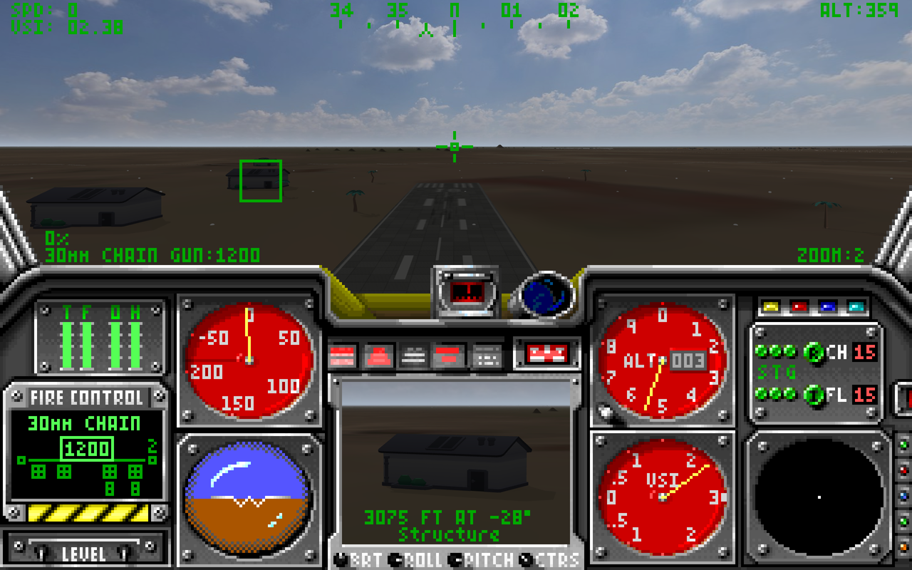
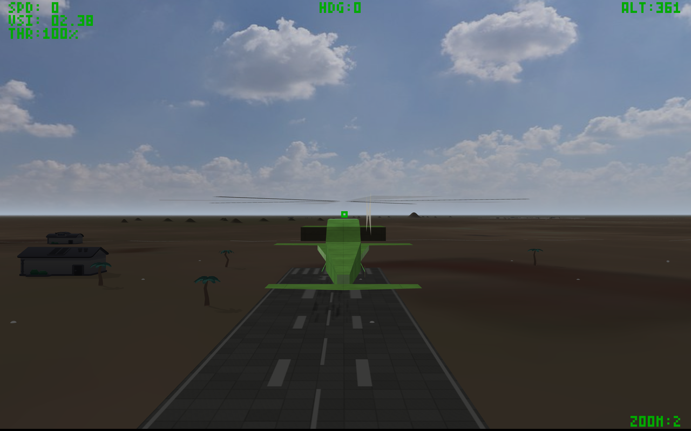
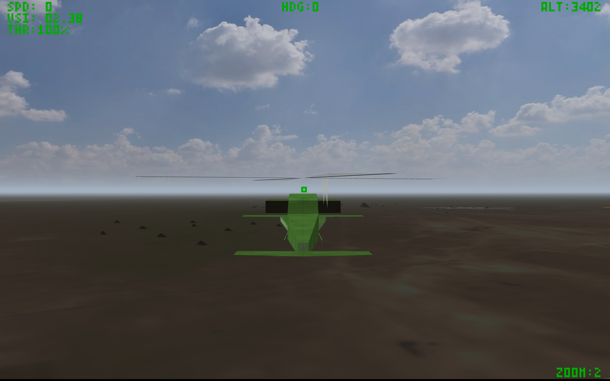

# LHX: Attack Chopper — native Linux

I'm in my 40s and I remember playing this game as a kid, and getting my mind
blown when the Osprey would turn into a plane.

This is my attempt to bring it back as a native Linux application: preserve the
original flight model, missions and cockpit, improve the rendering, and make it
comfortable to play with a modern controller. The original DOS executable is
translated into C at build time and compiled locally. SDL2 handles the window,
input and sound; OpenGL draws the enhanced world.

**Built on [kznsq's LHX: Attack Chopper — GPU 3D](https://github.com/kznsq/lhx-attack-chopper-gpu).**
His recovery of the engine's scene data, camera projection, compositing and
Enhanced-mode visuals made this project possible. This native implementation
also uses [sp00nz's PCRecomp](https://github.com/sp00nznet/pcrecomp) translation
tools. Please check out and credit their work.



*Actual gameplay captured from the native GPU renderer. [Screenshot credits](docs/screenshots/README.md).*

## What works

- Native OpenGL rendering, up to a 2560×1600 world canvas, with antialiasing and
  a CPU fallback. The original cockpit and HUD retain their pixel artwork.
- Extended visibility, satellite imagery and visual terrain relief across
  Libya, Vietnam and Europe; cloud/night skies and horizon haze.
- Replacement buildings and trees, sun/contact shadows, runway markings,
  service paint, aircraft panel detail, vehicle camouflage and spinning rotors.
- Original menus, mission callbacks and flight dynamics; original PC speaker
  sound or optional [procedural stereo audio](docs/AUDIO.md).
- Keyboard, SDL gamepads and native joysticks, including a tested Logitech F310 mapping,
  usable collective controls, held fire, [manual TOW guidance](docs/WEAPONS.md),
  chaff and flares.
- Configurable graphics and controls through the existing [controls.ini](controls.ini).

This is an experimental reimplementation, not a finished remaster. Automated
checks cover boot, menus, AH-64 takeoff, firing, TOW guidance, camera changes and sustained
climbs. Mission completion and the other aircraft need more playtesting.

## Bring your own game

**No game files, disc images, generated translations, native game binaries or
optional art packs are included.** You need your own copy of the supported
**Hit Squad CD release**. Other releases are rejected by the translator's
input-hash checks; they have not been validated.

The supported packed `LHX.EXE` SHA-256 is:

```text
d0afb93033121ba2403cf4f82afa6865e4b889e961733e791aa5929b94e7d325
```

Put your disc image at `bin/LHX.iso`. It must contain the game under
`HITSQUAD/LHX/`. The preparation step reads the ISO directly; it does not mount
it or download game content.

## Build and run

Requirements: Linux, a C11 compiler, CMake 3.20+, Python 3.10+, pkg-config and SDL2
development files. OpenGL development files and an OpenGL 3.3 driver enable the
GPU backend. ImageMagick is optional and used only to prepare enhanced art.

From the repository directory:

```sh
mkdir -p bin
# Place your own supported disc image at bin/LHX.iso.
./run.sh
```

The first run extracts the game, unpacks EXEPACK, translates the supported code
and builds `build/cmake/lhx-native`. Later runs reuse unchanged generated files.
There is no DOSBox or CPU instruction interpreter in the running game.

```sh
./run.sh --render-scale 6       # 1920×1200 world canvas
./run.sh --backend cpu --render-scale 3
./run.sh --renderer original   # original 320×200 rendering
./run.sh --show-fps            # F12 toggles the counter during play
./run.sh --configure-controls  # optional controller setup before the game
```

The supplied INI enables the graphics options and a 2560×1600 GPU canvas.
Without optional art, the game keeps its original scenery and sky. GPU startup
prints the actual device; unavailable GPU support falls back to CPU rendering.
Use a lower render scale for the CPU fallback.

Saves go to ignored `saves/`; `--save-dir PATH` selects another directory.
The supplied INI enables improved sounds under `[audio]`; set
`improved_sounds = false` for the classic sound. [Audio options](docs/AUDIO.md).
[Build details, validation and the supported-code approach](docs/DEVELOPMENT.md)
are documented separately.

## Optional enhanced art

The screenshots show separately prepared assets from
[kznsq's reference project](https://github.com/kznsq/lhx-attack-chopper-gpu).
To reproduce that appearance, obtain a local checkout of the reference project
and run these importers, replacing `/path/to/reference` with its directory:

```sh
python3 tools/import_terrain.py --source /path/to/reference/assets/terrain
python3 tools/import_relief.py  --source /path/to/reference/assets/terrain
python3 tools/import_scenery.py --source /path/to/reference/assets/models/kenney
python3 tools/import_skies.py   --source /path/to/reference/assets/sky
```

The importers read the reference checkout without modifying it and write local
resources to ignored `bin/enhanced/`. They retain source hashes and attribution.
The game has no network dependency at runtime.

The supplied profile selects the approved subtle daytime sky at
`bin/enhanced/sky-subtle/`, paired with the original photo night sky.
Use `sky_dir = bin/enhanced/sky` for the original photo pack. Custom sky
preparation and the original-sky fallback are covered in the rendering guide below.

[Rendering options and asset preparation](docs/RENDERING.md) explain each INI
setting, fallback behavior and resource requirements. Terrain relief changes
appearance; the original flight altitude and collision surfaces remain in use.

<details>
<summary>More gameplay screenshots</summary>





These are gameplay captures, resized for documentation.
[Image credits and capture notes](docs/screenshots/README.md).

</details>

## Controls

| Input | Action |
| --- | --- |
| Enter / arrows | Menus |
| Top-row **5** | Maximum collective for takeoff |
| Top-row **3** | Original aircraft lift preset |
| Keypad **5** or **/** | Centre the flight stick |
| **G** | Landing gear on LHX and Osprey |
| **F1** / **F5** | Cockpit / chase view |
| **F12** | FPS counter |

Optional multi-USB setup supports independent stick, lever, pedals and button-box
bindings. Run `./run.sh --configure-controls`, choose **Multi-USB bindings**, enable
your devices, then select an action and **Add binding**. Calibration and USB
profiles save in the same INI; Session and Cancel leave the file untouched.
For the exact Linux PC-mode HOTAS One with TFRP pedals, press **H / HOTAS One +
pedals** on the initial setup screen for stick, direct throttle and pedal yaw.
The preset fills unused bindings and preserves custom controls and calibration.

Gamepads connect automatically. The supplied F310 layout uses the left stick
for cyclic, right stick for rudder/collective, RT to fire, X for chaff and Y for
flares. [Complete controller mapping and INI configuration](docs/CONTROLS.md).

## Development

The source tests can run without game assets; checks requiring the original
files skip when they are absent:

```sh
python3 -m unittest discover -s tests -v
```

After building with your own supported game data:

```sh
ctest --test-dir build/cmake --output-on-failure
```

See [development notes](docs/DEVELOPMENT.md) for deterministic flight checks,
rendering measurements and implementation limits. [Source export instructions](docs/PUBLISHING.md)
describe how to create an audited package containing code, documentation and
these screenshots.

## Credits and licence

- **[kznsq](https://github.com/kznsq)** —
  [LHX: Attack Chopper — GPU 3D](https://github.com/kznsq/lhx-attack-chopper-gpu):
  engine research, capture/compositing, projection and the Enhanced-mode work
  adapted here. The upstream MIT notice is retained.
- **[sp00nz](https://github.com/sp00nznet)** —
  [PCRecomp](https://github.com/sp00nznet/pcrecomp) and
  [Wolf3D Recomp](https://github.com/sp00nznet/wolf3d-recomp): translation tools,
  CPU helpers and the function-discovery approach.
- **Electronic Arts** — the original *LHX: Attack Chopper* and its game artwork.
  A special shout-out to **[Brent Iverson](https://en.wikipedia.org/wiki/Brent_Iverson)**,
  LHX's designer and development lead, and a personal hero of mine. Thank you,
  Brent, for the childhood memories and for making that Osprey transformation
  feel like magic.
- **Kenney, Poly Haven, EOX/Copernicus, OpenStreetMap contributors and the Terrain
  Tiles source datasets** — separately imported scenery, skies and geographic
  data. See [THIRD-PARTY.txt](THIRD-PARTY.txt) and the
  [screenshot credits](docs/screenshots/README.md).

Original project code is under the [MIT licence](LICENSE). Third-party code
retains its own notices. The code licence does not grant rights to the original
game or the assets depicted in screenshots. This is an unofficial project,
without affiliation with Electronic Arts or the upstream authors.
